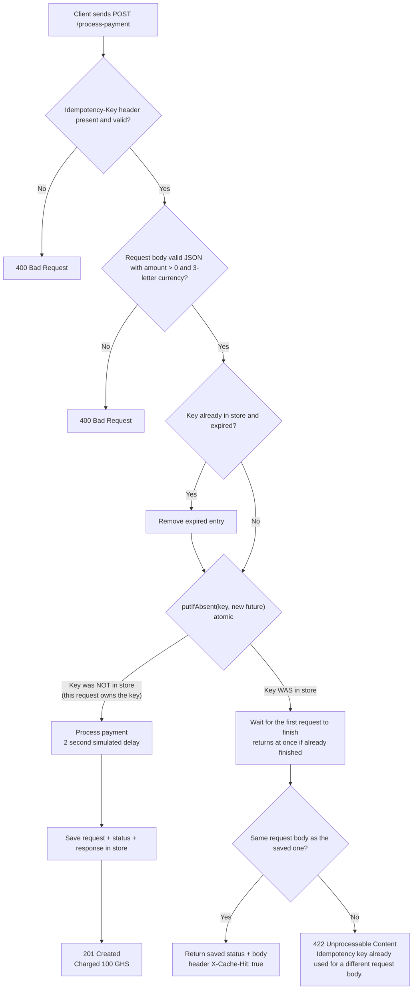
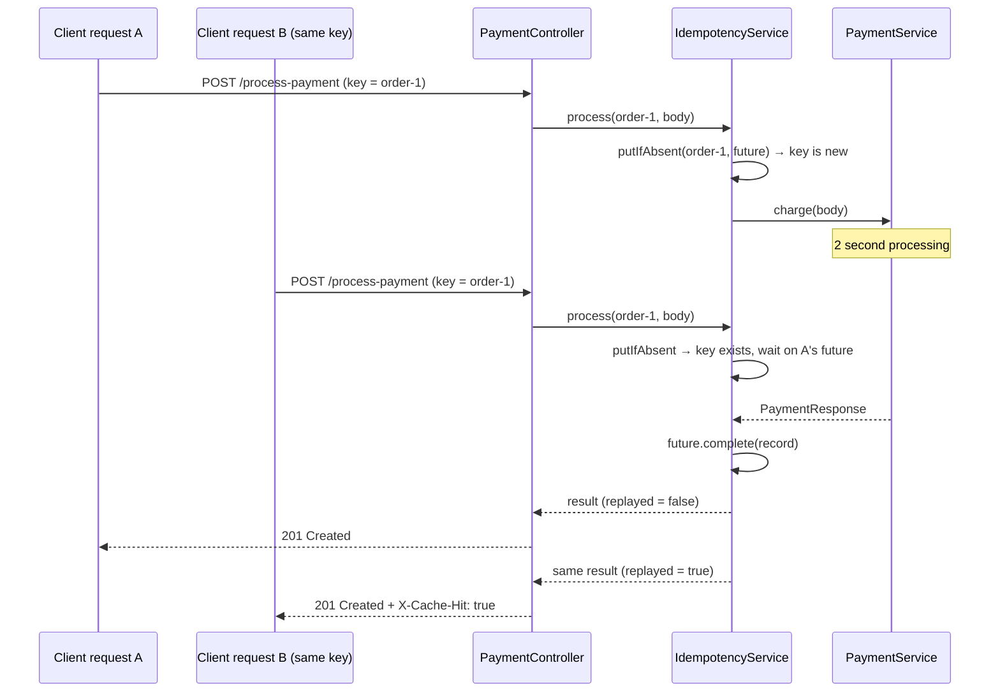

# Idempotency Gateway — The "Pay-Once" Protocol

A Spring Boot REST API that sits in front of a (simulated) payment processor and guarantees that **a payment is processed exactly once**, no matter how many times a client retries the same request.

Built for **FinSafe Transactions Ltd.**, whose e-commerce clients automatically retry payment requests after network timeouts and were double-charging customers.

---

## Table of Contents

1. [Architecture Diagram](#1-architecture-diagram)
2. [Setup Instructions](#2-setup-instructions)
3. [API Documentation](#3-api-documentation)
4. [Design Decisions](#4-design-decisions)
5. [The Developer's Choice: Idempotency Key Expiry (TTL)](#5-the-developers-choice-idempotency-key-expiry-ttl)
6. [Project Structure](#6-project-structure)
7. [Testing](#7-testing)
8. [Known Limitations](#8-known-limitations)

---

## 1. Architecture Diagram

### Request flow (flowchart)



### Two identical requests arriving at the same time (sequence diagram)



### Layers

| Layer | Class | Responsibility |
|---|---|---|
| Controller | `PaymentController` | HTTP only: reads the header and body, validates, builds the response and the `X-Cache-Hit` header |
| Service | `IdempotencyService` | The idempotency logic: owns the key store, decides process / replay / reject, handles concurrency and expiry |
| Service | `PaymentService` | The (simulated) payment processor: 2 second delay, builds the payment result |
| Error handling | `GlobalExceptionHandler` | Turns exceptions into consistent JSON error responses |

---

## 2. Setup Instructions

### Prerequisites

- **Java 17 or newer** (check with `java -version`)
- Nothing else. Maven is downloaded automatically by the included Maven Wrapper (`mvnw`). No database, Docker or Redis is required.

### Run the server

```bash
git clone https://github.com/Sheila5rwa/AmaliTech-DEG-Project-based-challenges.git
cd AmaliTech-DEG-Project-based-challenges/backend/Idempotency-gateway

# macOS / Linux
./mvnw spring-boot:run

# Windows (PowerShell)
.\mvnw.cmd spring-boot:run
```

The server starts on **http://localhost:8080**. Ready when the log shows `Started IdempotencyGatewayApplication`.

### Run the tests

```bash
./mvnw test          # macOS / Linux
.\mvnw.cmd test      # Windows
```

### Configuration

`src/main/resources/application.properties`:

| Property | Default | Meaning |
|---|---|---|
| `idempotency.key-ttl-seconds` | `86400` (24 hours) | How long a saved idempotency key is remembered |

---

## 3. API Documentation

### `POST /process-payment`

Processes a payment exactly once per `Idempotency-Key`.

**Headers**

| Header | Required | Description |
|---|---|---|
| `Idempotency-Key` | Yes | A unique string chosen by the client for this payment (max 255 characters), e.g. a UUID or order ID |
| `Content-Type` | Yes | `application/json` |

**Request body**

```json
{ "amount": 100, "currency": "GHS" }
```

| Field | Type | Rules |
|---|---|---|
| `amount` | number | Required, greater than 0 |
| `currency` | string | Required, 3 capital letters (e.g. `GHS`, `USD`) |

### Responses

| Situation | Status | Extra header | Body |
|---|---|---|---|
| First request with a new key | `201 Created` (after ~2 s) | — | Payment result |
| Retry: same key, same body | `201 Created` (instant) | `X-Cache-Hit: true` | **Exactly** the same body as the first response |
| Same key, different body | `422 Unprocessable Content` | — | Error |
| Same key while the first request is still processing | Waits, then `201 Created` | `X-Cache-Hit: true` | Result of the first request |
| Missing / empty / too long `Idempotency-Key` | `400 Bad Request` | — | Error |
| Invalid amount or currency | `400 Bad Request` | — | Error |
| Missing or malformed JSON body | `400 Bad Request` | — | Error |

**Success body (201)**

```json
{
  "transactionId": "txn_c573a412-4466-4a61-9aa5-e024fa5147df",
  "status": "SUCCESS",
  "amount": 100,
  "currency": "GHS",
  "message": "Charged 100 GHS",
  "processedAt": "2026-11-14T09:43:08.446072900Z"
}
```

**Error body (example: 422)**

```json
{
  "status": 422,
  "error": "Unprocessable Content",
  "message": "Idempotency key already used for a different request body."
}
```

### Example requests

The `test-requests/` folder contains ready-made request bodies. Run these from the `Idempotency-gateway` folder.

**1. First payment** — about 2 seconds, then `201`:

```bash
curl -i -X POST http://localhost:8080/process-payment \
  -H "Content-Type: application/json" \
  -H "Idempotency-Key: order-001" \
  --data @test-requests/payment-100.json
```

**2. Retry the same request** — instant, `201`, `X-Cache-Hit: true`, same `transactionId`:

```bash
curl -i -X POST http://localhost:8080/process-payment \
  -H "Content-Type: application/json" \
  -H "Idempotency-Key: order-001" \
  --data @test-requests/payment-100.json
```

**3. Same key, different amount** — `422`:

```bash
curl -i -X POST http://localhost:8080/process-payment \
  -H "Content-Type: application/json" \
  -H "Idempotency-Key: order-001" \
  --data @test-requests/payment-500.json
```

**4. Missing header** — `400`:

```bash
curl -i -X POST http://localhost:8080/process-payment \
  -H "Content-Type: application/json" \
  --data @test-requests/payment-100.json
```

> **Windows PowerShell:** use `curl.exe` instead of `curl`, put the whole command on one line, and quote the file: `--data "@test-requests/payment-100.json"`.

---

## 4. Design Decisions

**1. Replay, don't reject.**
A client that timed out does not know whether its first attempt succeeded. Rejecting the retry tells it nothing; replaying the saved response tells it "you were charged, here is the receipt". So a duplicate returns the original status code and body, not an error.

**2. In-memory store (`ConcurrentHashMap`) instead of a database.**
The brief allows a native Map. It keeps the project runnable with a single command and no database setup. `ConcurrentHashMap` is thread-safe, which matters because a web server handles many requests in parallel. Trade-off: saved keys are lost when the server restarts, and the store is not shared between multiple server instances (see [Known Limitations](#8-known-limitations)).

**3. Atomic `putIfAbsent` with a `CompletableFuture` to prevent race conditions.**
A naive "check if key exists, then save it" leaves a gap: two simultaneous requests can both pass the check and both charge the customer. Instead, the first request atomically places a `CompletableFuture` (a "result coming soon" placeholder) in the map *before* charging. Any request that arrives with the same key finds the placeholder and waits for it, then replays the result. This solves the bonus "in-flight" story: request B neither starts a second payment nor gets a `409`.

**4. `422` for "same key, different body".**
The brief allows `409` or `422`. The IETF draft for the `Idempotency-Key` header (draft-ietf-httpapi-idempotency-key-header) recommends `422` when a key is reused with a different payload, and reserves `409` for "the original request is still in progress". We follow the draft.

**5. Request bodies are compared by value, not raw text.**
`{"amount":100,"currency":"GHS"}` and `{"currency":"GHS","amount":100.00}` are the same payment, so they are treated as a duplicate. Amounts are compared with `BigDecimal.compareTo` (which ignores scale, so `100` equals `100.00`), not `equals`.

**6. `BigDecimal` for money.**
`double` cannot represent many decimal values exactly (`0.1 + 0.2 = 0.30000000000000004`), which is unacceptable for payments.

**7. Validation happens before the idempotency check.**
`@Valid` rejects bad input (negative amount, bad currency, broken JSON) with `400` before anything is charged or stored. Because invalid requests are never stored, a client can fix its mistake and retry with the same key.

**8. Only successful results are cached.**
If processing throws an exception, the key is removed from the store, so a retry can be processed normally instead of being stuck with a cached failure.

**9. `201 Created` for a successful charge.**
The request creates a new resource (a transaction). The brief allows `200` or `201`.

**10. Assumptions where the brief was silent.**
- Missing or empty `Idempotency-Key` → `400 Bad Request`.
- `X-Cache-Hit: true` is sent only on replayed responses; first responses do not include the header.
- Keys are limited to 255 characters to stop clients from storing huge strings.

**11. Layered design (Controller → Service).**
The controller only deals with HTTP; `IdempotencyService` contains the idempotency logic; `PaymentService` is the payment processor. This keeps each class small, testable, and replaceable (for example, `PaymentService` could call a real payment provider without touching the idempotency logic).

---

## 5. The Developer's Choice: Idempotency Key Expiry (TTL)

### What it does

Every saved idempotency key now **expires after 24 hours** (configurable via `idempotency.key-ttl-seconds`).

- When a request arrives with a key whose saved result is older than the TTL, the old entry is removed and the request is processed as a new payment.
- A background job (`@Scheduled`, every 60 seconds) removes expired keys from memory.
- Keys that are still being processed never expire mid-flight.

### Why I added it

1. **Without it, memory grows forever.** Every payment adds an entry to the in-memory store and nothing ever removes it. In a real payment processor handling thousands of payments a day, the server would eventually run out of memory and crash, taking payments down with it.
2. **It matches industry practice.** Real payment APIs such as Stripe remember idempotency keys for about 24 hours. Retries happen within seconds or minutes of a timeout, so 24 hours comfortably covers every genuine retry.
3. **It keeps the system predictable.** A key reused days later is almost certainly a new, unrelated payment (or a client bug), not a network retry; keeping it forever would block that client indefinitely.

### How it is tested

`IdempotencyKeyExpiryTest` starts the application with a 1-second TTL, sends a payment, waits for the key to expire, and checks that the same key is then processed as a brand-new payment (new `transactionId`, no `X-Cache-Hit` header).

---

## 6. Project Structure

```
Idempotency-gateway/
├── pom.xml                         Maven build (Spring Boot)
├── mvnw, mvnw.cmd, .mvn/           Maven Wrapper (no Maven install needed)
├── test-requests/                  Example JSON bodies for curl
└── src/
    ├── main/java/com/finsafe/idempotency_gateway/
    │   ├── IdempotencyGatewayApplication.java
    │   ├── controller/PaymentController.java
    │   ├── service/IdempotencyService.java
    │   ├── service/PaymentService.java
    │   ├── model/                  PaymentRequest, PaymentResponse, IdempotencyRecord,
    │   │                           IdempotencyResult, ErrorResponse
    │   └── exception/              GlobalExceptionHandler, IdempotencyKeyConflictException,
    │                               InvalidIdempotencyKeyException
    ├── main/resources/application.properties
    └── test/java/com/finsafe/idempotency_gateway/
        ├── controller/PaymentControllerTest.java
        └── controller/IdempotencyKeyExpiryTest.java
```

---

## 7. Testing

Automated tests use **JUnit 5**, **Spring Boot Test** and **MockMvc**. Run with `./mvnw test`.

| Test | What it proves |
|---|---|
| `firstRequest_isProcessedAndReturns201` | User Story 1: `201`, `"Charged 100 GHS"`, takes ≥ 2 s |
| `duplicateRequest_returnsSameResponseInstantlyWithCacheHitHeader` | User Story 2: identical body, `X-Cache-Hit: true`, < 1 s |
| `reorderedJsonWithSameValues_isTreatedAsDuplicate` | Bodies are compared by value |
| `sameKeyWithDifferentBody_returns422` | User Story 3: `422` with the required message |
| `concurrentRequestsWithSameKey_areChargedOnlyOnce` | Bonus: two simultaneous requests → one charge, both `201`, one replay |
| `missingIdempotencyKey_returns400` | Error handling |
| `negativeAmount_returns400` | Validation |
| `invalidJson_returns400` | Error handling |
| `invalidRequest_doesNotConsumeKey` | A rejected request does not block the key |
| `expiredKey_isProcessedAsNewRequest` | Developer's Choice: key expiry |

---

## 8. Known Limitations

These are deliberate trade-offs to keep the project simple, with the production fix for each:

| Limitation | Production fix |
|---|---|
| Keys are lost on restart | Store keys in a database (e.g. PostgreSQL table with a `UNIQUE` key column) or Redis |
| Store is per-server; two server instances would not share keys | Shared store (Redis `SET NX` or a database row lock) |
| A waiting request blocks a server thread with no timeout | Add a wait timeout and return `409` ("still processing, retry later") |
| Keys are global, not per client | Scope keys by client/merchant ID once authentication exists |